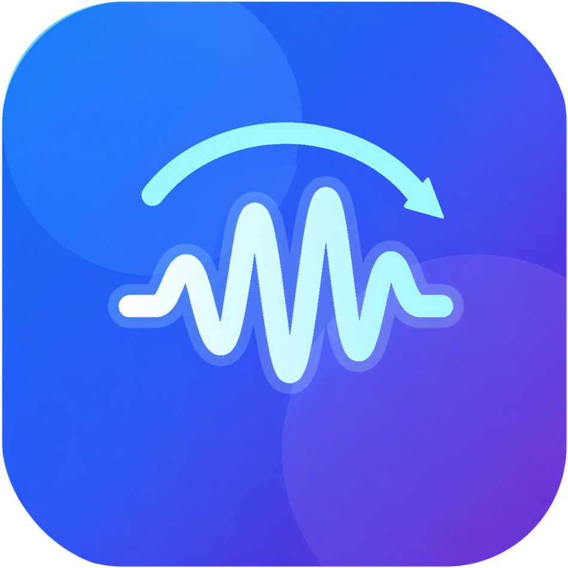

# BT192 Switch

**当前版本：V3.0**

BT192 Switch是一款Android蓝牙音频采样率自动切换工具。耳机连接后，在设备和系统支持的条件下自动切换至 **192kHz**，减少重复手动设置。

## 功能特点

- **自动切换**：为已关联并启用的耳机自动设置目标采样率。
- **独立管理**：每台耳机拥有独立的自动切换开关。
- **设备排序**：拖动调整设备顺序，方便管理常用耳机。
- **状态提示**：查看设备关联、权限及后台运行相关提示。
- **手机与平板适配**：针对不同屏幕提供相应的界面布局。

## 使用方法

1. 在系统蓝牙设置中完成耳机配对。
2. 打开BT192 Switch，点击 **发现并关联耳机**，按系统提示完成关联。
3. 根据应用提示授予附近设备权限、开启无障碍服务，并检查后台运行设置。
4. 打开对应耳机的 **自动切换** 开关。
5. 后续连接耳机时，应用会在条件满足时自动执行切换。

首次使用建议确认耳机实际支持的编码与采样率。若系统对后台运行有限制，请检查电池优化及相关省电设置。

## 已验证设备

目前仅在以下两个设备上进行过验证：

| 设备 | 类型 |
|---|---|
| 小米15 | 手机 |
| 小米Pad 7S Pro | 平板 |

其他设备尚未验证。实际效果还取决于系统版本、耳机和蓝牙编码配置，不保证所有设备组合均兼容。

## 使用须知

- 192kHz切换需要系统、耳机及当前编码配置共同支持，应用无法突破硬件或系统限制。
- 采样率设置不等于音质保证，也不代表码率会同时提高。
- 系统更新、蓝牙编码变化或后台限制可能影响自动切换效果。
- 不建议同时启用多个自动控制同一副耳机的工具，以免设置相互覆盖。
- 更新应用时建议直接覆盖安装，不要先卸载或清除数据，以保留原有配置。若出现错误，请保留提示后反馈，不必关闭系统安全检查强行安装。

## 问题反馈

遇到问题可在[Issues](https://github.com/Slacom/Bt192-Auto-Switch/issues)中反馈。建议提供设备型号、系统版本、耳机型号、所用编码以及问题出现的步骤；提交截图或日志前请遮盖蓝牙地址等个人信息。

## 声明与许可

BT192 Switch是非官方应用，与相关耳机、芯片及编码器厂商不存在隶属、赞助或认可关系。文中第三方名称仅用于技术说明，相关权利归各自权利人所有。

第三方组件遵循各自的许可要求，详见[第三方声明](<构建脚本/v3/v3_026/licenses/THIRD_PARTY_NOTICES.txt>)及[Apache License 2.0](<构建脚本/v3/v3_026/licenses/Apache-2.0.txt>)。本项目自有代码及素材未另行授予统一开源许可证，公开源码不等同于允许任意再许可或再分发。
